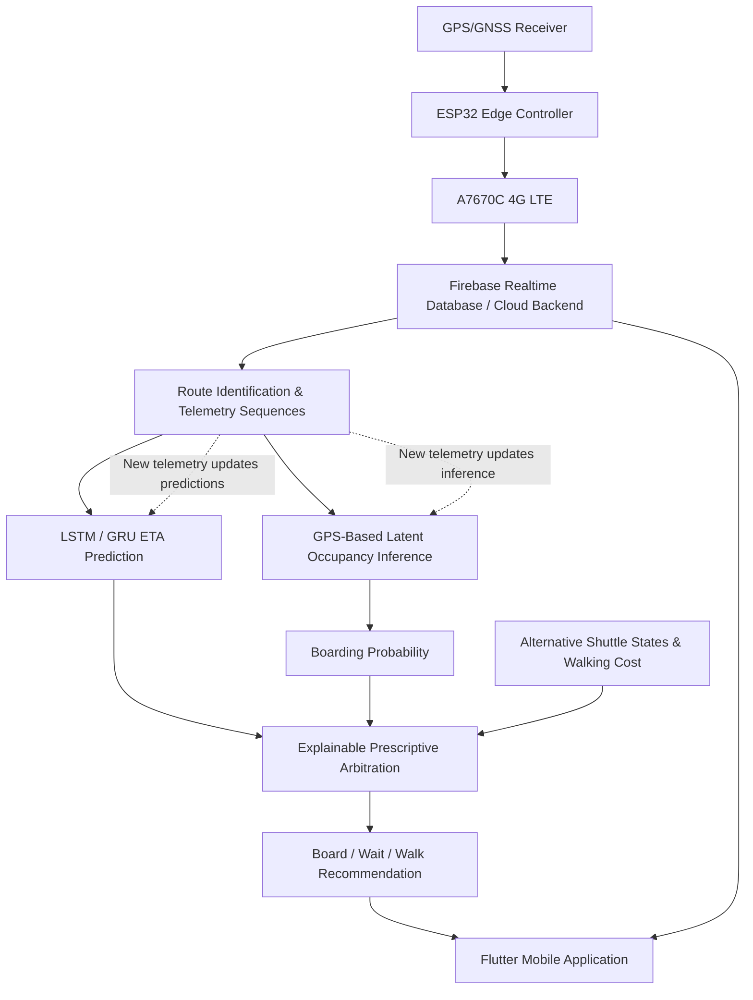

# 🚌 Intelligent Passenger-Centric Shuttle Recommendation System

### Hardware-Free GPS-Based Occupancy Inference & Explainable Prescriptive Decision Arbitration (EPA)

**An IoT–AI–mobile framework that helps passengers decide whether to board, wait, or walk—not just when a shuttle will arrive.**

---

## 📌 Overview

Most shuttle tracking applications show a vehicle's live location and **estimated time of arrival (ETA)**. But a shuttle arriving soon may be too crowded for a passenger to board. This mismatch between a visible ETA and an actual boarding opportunity creates a **“phantom capacity” problem**.

This research prototype proposes a passenger-centric recommendation system that combines:

- **Real-time GPS/GNSS tracking** using ESP32 and A7670C 4G LTE connectivity.
- **Sequential ETA prediction** based on historical and real-time movement patterns using LSTM and/or GRU models.
- **Hardware-free latent occupancy inference** from GPS-derived movement signals, including stop dwell times and inter-stop behavior.
- **Explainable Prescriptive Arbitration (EPA)** to compare candidate actions and recommend **Board, Wait, or Walk**.
- **Firebase cloud synchronization** and a **Flutter mobile interface** for passenger-facing information.

> **Key idea:** The objective is not merely to predict *when* a shuttle will arrive, but to help determine *what a passenger should do* based on time and the estimated likelihood of boarding.

## 🎯 Problem Statement

Conventional ETA-focused shuttle systems have several limitations:

1. **Capacity blindness:** The soonest-arriving shuttle may already be full.
2. **Dedicated sensor dependence:** Direct passenger counting can require cameras, infrared sensors, weight sensors, or ticketing infrastructure.
3. **Limited decision support:** Passengers may receive live locations and ETAs but must still decide whether to board, wait for another vehicle, or walk.
4. **Changing conditions:** New movement observations can change predicted arrival and inferred capacity states.

The proposed system brings these considerations into a single, continuously updated recommendation process.

## ✨ Research Contributions

| Component | Purpose |
| --- | --- |
| **Hardware-free occupancy inference** | Infers *latent crowding states* (Low, Medium, High) from GPS mobility patterns, without dedicated **passenger-counting** sensors. |
| **Boarding probability** | Converts inferred crowding into an estimated probability of successful boarding. |
| **LSTM/GRU ETA prediction** | Learns temporal patterns from ordered shuttle telemetry to predict remaining travel time. |
| **Explainable Prescriptive Arbitration (EPA)** | Evaluates predicted ETA, boarding probability, waiting cost, crowding and walking cost to recommend **Board**, **Wait**, or **Walk**. |
| **Continuous re-evaluation** | Recomputes predictions and decisions as new shuttle observations arrive. |
| **Integrated prototype** | Combines embedded tracking, cellular transfer, cloud storage and an Android-facing Flutter interface. |

**Important distinction:** “Hardware-free” applies to **occupancy inference**, not to shuttle tracking. The system still uses ESP32, GPS/GNSS, and cellular communication hardware.

## 🏗️ System Architecture

*Architecture adapted from the overall system diagram in the patent specification draft (Figure 1, page 22).*

## ⚙️ How It Works

1. **Acquire telemetry:** The GPS/GNSS receiver captures latitude, longitude, speed, and timestamp.
2. **Transmit data:** ESP32 processes the observations and sends them through the A7670C LTE module to the cloud.
3. **Identify route progress:** The backend associates locations with predefined routes and segments, maintaining time-ordered movement sequences.
4. **Predict ETA:** An LSTM and/or GRU prediction module estimates remaining shuttle travel time from sequential observations.
5. **Infer occupancy:** Stop dwell duration and inter-stop motion are analyzed to infer hidden crowding and estimate successful boarding probability.
6. **Arbitrate passenger actions:** EPA compares the expected costs of boarding, waiting for another shuttle, and walking, including a penalty for boarding-failure risk.
7. **Update the application:** The latest shuttle information, ETA, crowding indication, and recommended action are presented in Flutter. The process repeats as telemetry arrives.

### Example Decision Scenario

Suppose **Shuttle A** has a shorter ETA but is inferred to have high crowding, while **Shuttle B** is arriving later with a higher estimated boarding probability. The EPA engine may recommend **waiting for Shuttle B** instead of selecting Shuttle A based on ETA alone. If walking has the lowest calculated cost, the recommendation may instead be **Walk**.

*This is an illustrative scenario, not a measured experimental result.*

## 🧰 Technology Stack

| Layer | Technologies / Methods |
| --- | --- |
| Embedded controller | ESP32 DevKit |
| Location acquisition | GPS/GNSS module with external antenna |
| Cellular communication | A7670C 4G LTE module, SIM and LTE antenna |
| Cloud synchronization | Firebase Realtime Database |
| ETA prediction | LSTM and/or GRU recurrent neural networks |
| Occupancy inference | GPS-derived dwell duration and inter-stop movement characteristics |
| Decision engine | Explainable Prescriptive Arbitration (EPA), multi-objective disutility evaluation |
| Mobile application | Flutter (Android) |

## 📱 Passenger Application

The mobile application is described as presenting:

- Live shuttle location and route information.
- Dynamic predicted ETA.
- Inferred crowding state and estimated boarding probability.
- Passenger-specific **Board / Wait / Walk** recommendation.
- Continuously synchronized updates from the backend.

## 🧪 Prototype Validation

The patent specification draft reports **functional validation** of the integrated prototype. Its experimental tables record successful operation for GPS acquisition, ESP32 processing, 4G LTE telemetry transmission, Firebase synchronization, route information, and mobile location display. They also report functional operation of sequential ETA prediction, latent occupancy inference, EPA policy generation, and recommendation display.

**Evidence boundary:** The draft reports functional outcomes but does **not** provide numerical ETA error, occupancy classification accuracy, boarding-probability calibration, comparison baselines, or large-scale field-study results. These are important areas for additional experimental evaluation; no performance percentages are claimed here.

## 🔬 Potential Next Evaluation Steps

- Quantify ETA prediction error across multiple shuttle routes and operating conditions.
- Compare inferred occupancy states with independently recorded passenger counts.
- Evaluate how accurately estimated boarding probabilities match actual successful boarding.
- Measure whether EPA recommendations reduce unsuccessful waits compared with ETA-only selection.
- Test how well inference performs when long stop dwell times are caused by traffic or operational delays rather than passenger demand.

**From “When will my shuttle arrive?” to “What should I do next?”**

*IoT • GPS/GNSS • Intelligent ETA • Occupancy Inference • Explainable Decision Support*

